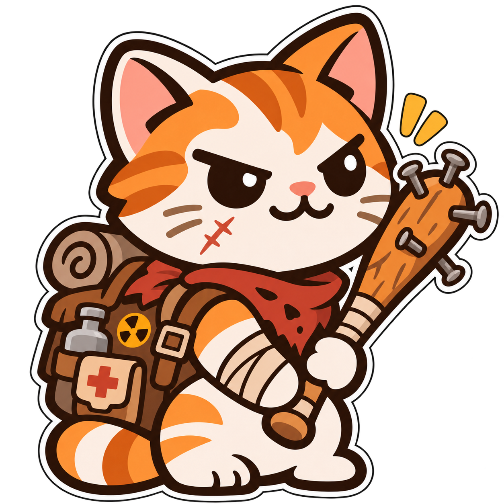

<h2 align="center">
  LiteDuck1986
</h2>

  

 

## 👋 Hello, I'm LiteDuck!

*3rd-Year Programming Technician Student @ Liepaja State Technical School*

Welcome to my GitHub! I'm a programmer and indie game developer who loves making small-to-medium projects and learn something new.

### 🤝 Let's Collaborate
While I'm used to working alone, I have experience working in online team before and am **always open to collaborative projects!** If you need someone who knows what he does, a dedicated bug hunter, or a Unity dev, feel free to reach out.

### Tools
* **Workflow:** Git & GitHub

 

<b>My Skills & Programming languages (click to expand)</b>

 

<tr>

### Game Engines

### Database

### Languages  

###

<picture>
  <source media="(prefers-color-scheme: dark)" srcset="https://raw.githubusercontent.com/LiteDuck1986/LiteDuck1986/output/pacman-contribution-graph-dark.svg">
  <source media="(prefers-color-scheme: light)" srcset="https://raw.githubusercontent.com/LiteDuck1986/LiteDuck1986/output/pacman-contribution-graph.svg">
  
</picture>

###

 

  

