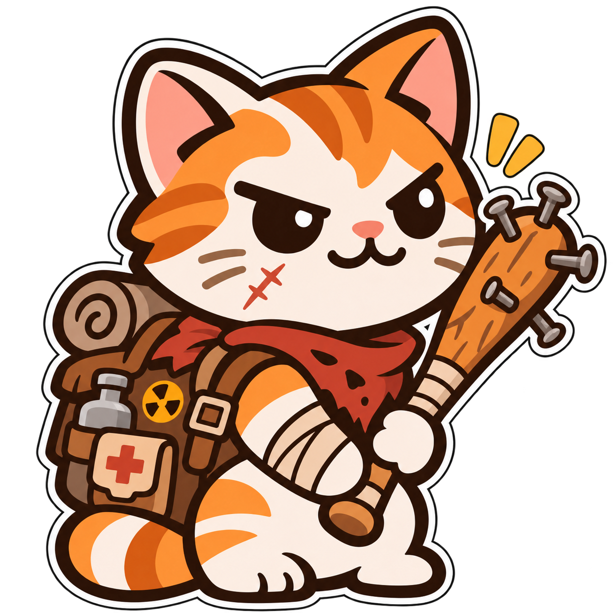

  
  
  

<h2 align="center">
LiteDuck1986
</h2>

  

 

## 👋 Hello, I'm LiteDuck!

*3rd-Year Programming Technician Student @ Liepaja State Technical School*

<h2>About Me!</h2>
> I'm a independent Indie Game Developer that mainly works in Unity.
 
> I can also work with frontend and backend website.

 

 

<b>My Stack (click to expand)</b>

 

  

