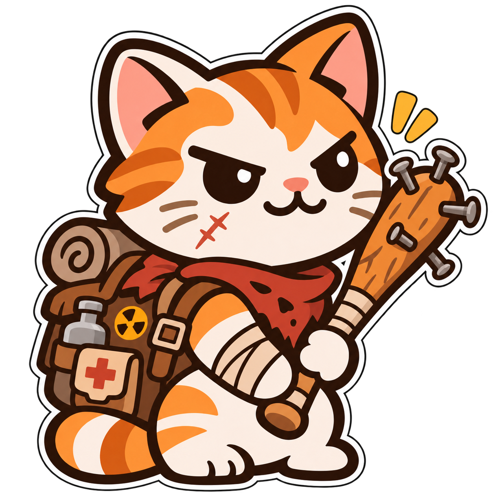

<!-- Language Switcher Buttons -->

  
  
  

<h2 align="center">
LiteDuck1986
</h2>

  

 

## 👋 Привет, я LiteDuck!

*Студент 3-го курса по специальности «Техник-программист» @ Лиепайский государственный техникум*

<h2>Обо мне!</h2>

> Я независимый инди-разработчик игр, в основном работаю на Unity.
 
> Также занимаюсь frontend и backend веб-разработкой.

 

<b>Мой стек (нажмите, чтобы раскрыть)</b>

 

 

 

  

